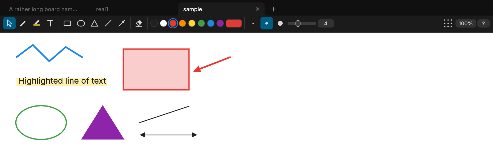

# Drafty

A small desktop whiteboard for sketching quick explanations. Draw some boxes and arrows, paste a screenshot and mark it up, then copy the result straight into a chat.

It sits between MS Paint and a screenshot annotator: fewer tools than Paint, but a real app with tabs that you open and work in. Native on Linux and macOS, a single 9 MB binary, starts in about 100 ms and uses no CPU while idle.



## Features

- **Tools:** pen, highlighter, text, rectangle, ellipse, triangle, line, arrow, eraser and select. Shift draws squares, circles and 15° lines.
- **Infinite board** with pan and zoom.
- **Images:** paste a screenshot with `Ctrl+V`, or `Ctrl+Shift+V` to open it in a new tab. Images can also be opened from files or dropped onto the window.
- **Sharing:** `Ctrl+Shift+C` copies the board, or just the selection, to the clipboard as a PNG.
- **Editing:** move, resize, restyle, duplicate and reorder objects. Right-click for a menu of object actions. Undo goes back 200 steps per tab.
- **Tabs:** several boards open at once. Open tabs are saved automatically and come back the next time you start Drafty, so you never lose a sketch by quitting.
- **Files:** save boards as `.drafty` files, export PNGs.

Press `?` in the app for all keyboard shortcuts.

## Install

You need a Rust toolchain, 1.88 or newer, from [rustup.rs](https://rustup.rs) or your package manager.

### Linux

```sh
make
make install                             # into ~/.local
sudo make install PREFIX=/usr/local      # or for all users
```

This installs the `drafty` binary, a menu entry, the icon, and a file type for `.drafty` boards. `make uninstall` removes them.

### macOS

```sh
./scripts/bundle-macos.sh                # or --universal for Apple Silicon + Intel
cp -r target/Drafty.app /Applications/
```

The macOS build hasn't been tested on a Mac yet.

### Run without installing

```sh
cargo run --release -- [FILE...]
```

Files can be `.drafty` boards or PNG/JPEG images. Each opens in its own tab.

## Known limitations

- On Wayland, dragging files onto the window doesn't work, because the windowing library only supports it on X11. Paste the image or use `Ctrl+O` instead. Starting Drafty with `WAYLAND_DISPLAY=` runs it through XWayland, where dragging works.
- On macOS, opening a file with Finder's "Open With" starts Drafty without the file.

## Development

```sh
cargo test                                               # unit, app and export tests
UPDATE_GOLDEN=1 cargo test                               # accept changed export images
cargo test --release -- --ignored frame_time --nocapture # frame time on big boards
```

`docs/PLAN.md` has the scope and measured performance, and `docs/ARCHITECTURE.md` explains how the code fits together.

## License

Copyright (C) 2026 Gustav Råkeberg

This program is free software: you can redistribute it and/or modify it under the terms of the GNU General Public License as published by the Free Software Foundation, either version 3 of the License, or (at your option) any later version.

This program is distributed in the hope that it will be useful, but WITHOUT ANY WARRANTY; without even the implied warranty of MERCHANTABILITY or FITNESS FOR A PARTICULAR PURPOSE. See [LICENSE](LICENSE) for the full text.

The bundled [Inter](https://github.com/rsms/inter) font is licensed under the SIL Open Font License 1.1. See [assets/Inter-LICENSE.txt](assets/Inter-LICENSE.txt).
